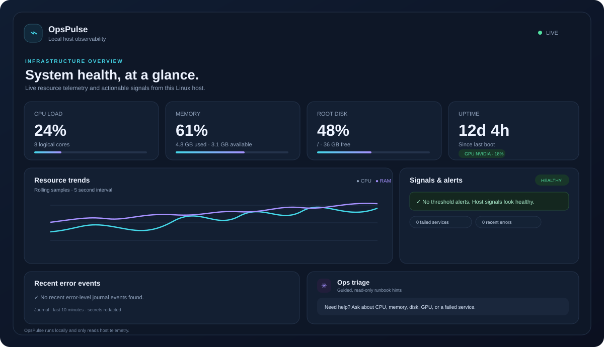

# OpsPulse

**A local-first Linux host health dashboard for small teams and homelabs.** OpsPulse collects CPU, memory, swap, filesystem, network, NVIDIA GPU, failed systemd service, and recent error-journal signals into a live dashboard with threshold alerts and a built-in, read-only triage guide.

> OpsPulse observes the machine where it runs. It does not run remediation commands, restart services, change configuration, or send telemetry to a hosted service.



## What it does

- Samples CPU and memory every five seconds and plots a rolling trend.
- Shows disk use for readable, non-pseudo filesystems, plus swap and network counters.
- Reads NVIDIA GPU utilization, VRAM and temperature when `nvidia-smi` is installed.
- Lists failed systemd units and error-level journal messages from the last ten minutes.
- Redacts common password, token, secret, API key, and authorization assignments in displayed journal lines.
- Flags CPU, memory and disk thresholds, with configurable warning levels.
- Offers a chat-style troubleshooting panel with safe diagnostic commands. It never executes suggestions.
- Exposes a small JSON API for scripts and future integrations.
- Runs locally by default and has a minimal GitHub Actions lint workflow.

## Quick start

Requirements: Python 3.10+, Linux with systemd for service and journal checks, and `nvidia-smi` for NVIDIA metrics.

```bash
git clone https://github.com/mohitchoudhary666/ops-pulse.git
cd ops-pulse
python3 -m venv .venv
source .venv/bin/activate
python -m pip install -r requirements.txt
python -m uvicorn ops_pulse.app:app --host 127.0.0.1 --port 8765
```

Open [http://127.0.0.1:8765](http://127.0.0.1:8765). API endpoints:

| Endpoint | Purpose |
| --- | --- |
| `/api/health` | Process liveness |
| `/api/snapshot` | Latest host metrics, alerts, and recent errors |
| `/api/history?limit=60` | Recent five-second metric samples |
| `/api/docs` | Interactive API reference |

## Configuration

Set optional environment variables before starting the server:

| Variable | Default | Purpose |
| --- | ---: | --- |
| `OPSPULSE_CPU_WARN` | `80` | CPU warning percentage |
| `OPSPULSE_MEMORY_WARN` | `85` | Memory warning percentage |
| `OPSPULSE_DISK_WARN` | `85` | Disk warning percentage |
| `OPSPULSE_LOG_LINES` | `80` | Maximum journal lines collected |

Example: `OPSPULSE_CPU_WARN=75 OPSPULSE_DISK_WARN=90 python -m uvicorn ops_pulse.app:app --host 127.0.0.1 --port 8765`.

## Access and privacy

- The server binds to loopback (`127.0.0.1`) in the quick start. Keep it local unless you add authentication and network controls.
- Metrics and log messages are returned by the local JSON API. Do not expose the API publicly or paste raw logs into public issues; logs can contain private host details.
- Journal and `systemctl` checks depend on local systemd availability and the current user's permissions. On distributions where journal access is restricted, run with an account that has read access to the system journal.
- GPU metrics are optional. OpsPulse reports when `nvidia-smi` is absent or cannot read a device.
- This is a single-host monitor, not an alert delivery service or fleet management platform.

## Architecture

```text
Linux host sensors ──> Python collector ──> in-memory rolling history
                             │                        │
                             └── FastAPI JSON API <── dashboard (5s polling)
```

Collection is read-only. The browser escapes host-provided strings before rendering them. The triage panel returns text guidance only and never executes shell commands.

## Contributing

Issues and pull requests are welcome. Keep checks read-only by default, avoid uploading raw host logs, and document platform or permission requirements. See [CONTRIBUTING.md](CONTRIBUTING.md).

## License

MIT. See [LICENSE](LICENSE).
